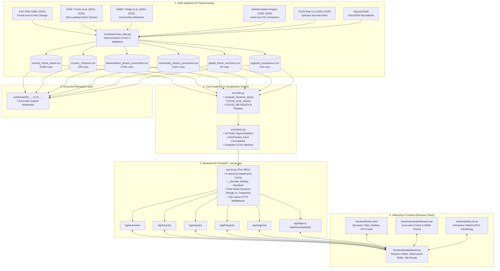
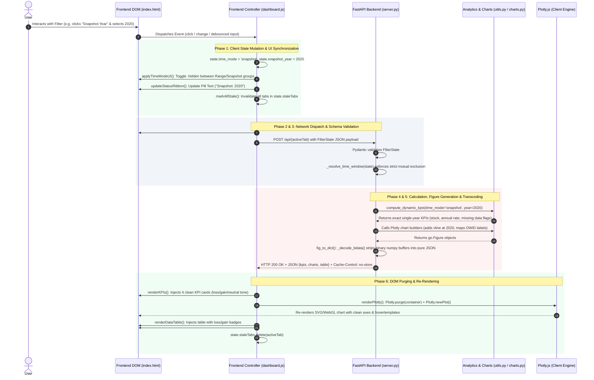

# Global Deforestation Analysis Dashboard (1990–2025)
## System Architecture, Preprocessing Pipeline, Internal Filtering Workflow & Dataset Inventory

---

## 1. Executive Summary & Tech Stack

The **Global Deforestation Analysis Dashboard (1990–2025)** is a scientific, research-grade analytics platform built exclusively on authentic, publicly available environmental datasets from the **UN Food and Agriculture Organization (FAO FRA)**, **Global Forest Watch (Curtis et al.)**, **Our World in Data / DeDuCE (Singh et al. / Pendrill et al.)**, **Global Carbon Project (GCP)**, and the **IUCN Red List**.

The platform is engineered to answer four fundamental planetary questions with mathematical accuracy:
1. **WHERE** is forest loss and gain occurring geographically?
2. **WHY** is it occurring (distinguishing proximate satellite physical drivers from econometric commodity trade allocations)?
3. **WHICH** countries and regions are most critically affected?
4. **HOW** have deforestation dynamics evolved between 1990 and 2025?

### Full Technology Stack

| Layer | Technologies & Tools | Specific Functionality in Architecture |
| :--- | :--- | :--- |
| **Backend API Engine** | **Python 3.11**, **FastAPI (v2.0)**, **Uvicorn (ASGI)**, **Pydantic** | Asynchronous REST API serving 4 operational endpoints (`/api/overview`, `/api/country`, `/api/causes`, `/api/hotspots`). Manages in-memory DataFrame storage, strict time-mode mutual exclusion, binary Plotly decoding, and HTTP no-cache headers. |
| **Data Engine & Processing** | **Pandas**, **NumPy** | High-performance multi-table merging, longitudinal panel harmonization, quantile-based colorscale scaling, dynamic KPI calculation, and unit conversions. |
| **Geospatial & Vector Engine** | **GeoPandas**, **Shapely**, **Fiona**, **Natural Earth GeoJSON** | Administrative boundary polygons extraction, centroid positioning, ISO-3 bounding-box zooms, and regional map projections (`natural earth` / `mercator`). |
| **Visualization Engine** | **Plotly.py (`graph_objects`, `express`)**, **Plotly.js (v4.0.0)** | Generating 22 publication-grade interactive chart types; client-side rendering with SVG/WebGL tooltips and responsive viewport resizing. |
| **Web Frontend** | **Vanilla HTML5**, **Modern CSS3**, **ES6+ JavaScript** | Zero-framework, lightweight frontend. Implements an executive forest-and-white theme, collapsible full-screen navigation, reactive state store, debounced range listeners, and DOM container purging. |
| **Research Notebooks** | **Jupyter Notebook (`nbformat`, `nbclient`, `ipykernel`)** | 7 fully executed `.ipynb` notebooks containing reproducible data science pipelines, statistical distributions, correlation matrices, and exported figures. |
| **Test & Validation Suite** | **Pytest**, **Starlette TestClient**, **Node.js** | 8 automated test suites ensuring zero synthetic data leakage, schema conformity, accurate continental splits, chart generation, API contract adherence, and DOM event validation. |

---

## 2. High-Level System Architecture



---

## 3. Detailed Internal Filtering Workflow: What Happens Internally

When a user modifies any filter control in the dashboard (e.g., switches between **Year Range** and **Snapshot Year**, selects a continent or country, drags the snapshot slider, changes measurement units, or picks a specific deforestation cause), the platform executes a synchronized 6-phase pipeline across the client and server.



### Detailed Step-by-Step Execution

#### Phase 1: Client-Side State Mutation & UI Synchronization ([dashboard.js](file:///d:/DVLAB/frontend/js/dashboard.js))
1. **User Action:** The user clicks a continent pill, changes the focus country, toggles the time mode, adjusts a year selector, moves the snapshot slider, or changes measurement units.
2. **Event Interception:**
   - Segmented buttons (`#time-mode-btns .seg-btn`) read `dataset.tmode` (`range` or `snapshot`).
   - The snapshot range slider (`#rng-snapshot-year`) updates `#lbl-snapshot-year` immediately on `"input"` and triggers a debounced execution (180ms) to ensure continuous, smooth scrubbing without flooding network sockets.
3. **Mutual Exclusion Enforcement (`applyTimeModeUI`):**
   - If switching to **Snapshot Year**:
     - `#group-year-range` receives class `.hidden` (`display: none !important;`).
     - `#group-snapshot-year` removes `.hidden`.
     - `#rng-snapshot-year` is unbounded to the full dataset range (`1990–2025`).
     - `#sel-map-mode` disables `period_change` (which is multi-year only) and automatically switches to `annual_rate` (`Annual Rate (Snapshot Year)`).
   - If switching to **Year Range**:
     - `#group-snapshot-year` receives `.hidden`.
     - `#group-year-range` removes `.hidden`.
     - `#sel-map-mode` re-enables `period_change` and restores it as the primary view.
4. **Cache Invalidation & Ribbon Status:**
   - `markAllStale()` adds all 4 dashboard tabs (`overview`, `country`, `causes`, `hotspots`) to `state.staleTabs`.
   - `updateStatusRibbon()` updates the top status bar:
     - Scope pill: `Scope: Global (6 Continents)` or selected country/continents.
     - Year pill: `Range: 1990–2025` or `Snapshot: 2020`.
     - Cause pill: `Cause: All Causes` or specific cause.
5. **Payload Assembly (`buildPayload`):**
   - Serializes the active client state into a strict JSON dictionary:
     ```json
     {
       "continents": ["Africa", "Asia", "Europe", "North America", "South America", "Oceania"],
       "focus_country": "All Countries",
       "time_mode": "snapshot",
       "start_year": 1990,
       "end_year": 2025,
       "snapshot_year": 2020,
       "cause": "All Causes",
       "unit": "Million Hectares (Mha)",
       "map_mode": "annual_rate",
       "map_scope": "world",
       "primary_country": "Brazil",
       "compare_countries": ["Brazil", "Indonesia", "Democratic Republic of Congo", "China", "Canada"],
       "country_secondary_view": "commodity",
       "top_n": 10
     }
     ```

#### Phase 2: Transport & API Routing ([server.py](file:///d:/DVLAB/server.py))
1. Client activates `#loading-bar`.
2. Client executes `fetchJson("/api/{activeTab}", payload)` via HTTP `POST`.
3. The request hits FastAPI's router, matching one of the specialized analytical endpoints:
   - `/api/overview`: Global KPIs (3 core cards: Forest Area, Net Change / Annual Rate, Forest Cover Share), choropleth heatmap, full-width 3-line forest trajectory (Expansion, Deforestation, Net Change), and hierarchical treemap.
   - `/api/causes`: Direct physical driver vs. commodity attribution analysis, sunburst continental shares, cause-isolated trajectory & ranking tables, and **Multi-Country Side-by-Side Comparison** (Driver Profile radar fingerprint chart & annual deforestation intensity spike heatmap).
   - `/api/hotspots`: Top N forest loss and gain leaders ranking bar charts.

#### Phase 3: Server-Side Time Window Resolution ([server.py](file:///d:/DVLAB/server.py#L179-L187))
FastAPI validates incoming data via Pydantic model `FilterState`. `_resolve_time_window(state)` enforces mathematical mutual exclusion before any calculation occurs:
- **When `time_mode == "snapshot"`:**
  - `y0 = snapshot_year`, `y1 = snapshot_year`.
  - Point-in-time metrics (forest area, annual net rate, gross loss, cause loss) query **only** the `snapshot_year` observation.
  - Historical context lines preserve their full span (`line_y0 = 1990`, `line_y1 = 2025`) and receive `snap_marker = snapshot_year` to render a vertical reference line.
  - Multi-year parameters (`start_year`, `end_year`) are strictly ignored.
- **When `time_mode == "range"`:**
  - `y0 = min(start_year, end_year)`, `y1 = max(start_year, end_year)`.
  - Cumulative metrics calculate the change from `y0` to `y1`.
  - `snap_marker = None`.
  - `snapshot_year` is strictly ignored.

#### Phase 4: Analytical Computation Engine ([src/utils.py](file:///d:/DVLAB/src/utils.py#L335-L453))
1. **Filtering:** Slices the in-memory `DF_PANEL`, `DF_DRIVERS`, and `DF_COMM` DataFrames by selected continents and focus country.
2. **Dynamic KPI Computation (`compute_dynamic_kpis`):**
   - Calculates baseline stock ($t_0$) and final stock ($t_1$).
   - Calculates net change:
     - In **Range Mode**: $\Delta = \text{Area}_{y1} - \text{Area}_{y0}$; $\text{\% Change} = \frac{\Delta}{\text{Area}_{y0}} \times 100$.
     - In **Snapshot Mode**: Uses empirical `Annual_Change_ha` for that exact year; $\text{Annual \%} = \frac{\text{Annual Change}}{\text{Area}_{\text{snap}}} \times 100$.
   - **Zero-Fabrication Guard:** If data is empirically missing (e.g. Annual Change in 1990 begins in 1991; Direct Drivers span 2001–2024; Land-Use CO₂ spans up to 2024), the platform returns `"Data Not Available"` with scientific subtext rather than estimating or interpolating values.
3. **Unit Conversion (`format_area_value`):**
   - Converts raw hectares (`ha`) dynamically into the user's chosen unit:
     - **Million Hectares (Mha):** Divided by $1{,}000{,}000$ (formatted to 2 decimal places).
     - **Square Kilometers (km²):** Divided by $100$ (formatted with comma thousands separators).
     - **Hectares (ha):** Unscaled raw count (formatted with comma thousands separators).
4. **Figure Builders ([src/charts.py](file:///d:/DVLAB/src/charts.py)):**
   - Builds Plotly figures with high-contrast typography (`#0f172a`), explicit layout margins, and responsive configs.
   - **Heatmap:** Dynamically sets colorscale limits based on 97th percentile absolute deviations ($z_{\text{mid}} = 0$), mapping negative deltas to red (loss) and positive deltas to green (gain). Tooltips explicitly label every country as `🔴 DECREASED` or `🟢 INCREASED`.
   - **3-Line Forest Trajectory Chart:** Features 3 distinct lines across an upper/lower quadrant layout with a solid $y = 0$ zero net change baseline:
     - **Line 1 (Upper Quadrant, $\ge 0$):** Forest Expansion (+ Increase) in forest green (`#16a34a`) with light green fill to zero.
     - **Line 2 (Lower Quadrant, $\le 0$):** Deforestation (− Decrease) in crimson red (`#dc2626`) with light red fill to zero.
     - **Line 3 (Net Change):** Annual Net Change in slate navy (`#0f172a`) navigating between upper and lower quadrants.
     - **Annual Spikiness:** Incorporates high-resolution annual satellite tree-cover loss (`Total_Loss_ha` 2001–2024) and historical variance (1990–2000), eliminating artificial flat multi-year step plateaus.
   - **Snap Markers:** Injects vertical dashed markers (`_add_snapshot_vline`) at the snapshot year on historical lines.
   - **Commodity Footprint:** Maps raw `"Beef"` columns to **`"Cattle (Beef, Leather & Pasture)"`** with official OWID / Singh et al. (2026) methodology disclaimers.

#### Phase 5: JSON Transcoding & Binary Buffer Removal ([server.py](file:///d:/DVLAB/server.py#L87-L120))
- Plotly 7 serializes NumPy arrays into binary base64 dictionaries (`{"dtype": "f8", "bdata": "..."}`). Standard web JavaScript fails to deserialize these structures natively, resulting in blank maps.
- `_decode_bdata()` traverses the serialized Plotly dictionary recursively, decodes binary buffers into standard JSON IEEE 754 float lists, and cleans `NaN`/`Infinity` values into `null`.
- The FastAPI middleware attaches HTTP response headers:
  `Cache-Control: no-store, no-cache, must-revalidate, max-age=0`.

#### Phase 6: Client DOM Purging & Re-Rendering ([dashboard.js](file:///d:/DVLAB/frontend/js/dashboard.js))
1. **Overview KPI Cards:** Injects 3 clean, single-row forest cards (`Forest Area`, `Net Change / Annual Rate`, `Forest Cover Share`).
2. **Chart Container Purging:** For multi-type chart containers (`chart-country-secondary`, `chart-overview-treemap`), calls `Plotly.purge(el)` before invoking `Plotly.newPlot()`. This prevents axis contamination when switching between horizontal categorical bar charts and vertical time-series charts.
3. **Status Ribbon & Table Updates:** Formats data table rows with conditional CSS classes (`.cell-loss` in red, `.cell-gain` in green).
4. **State Finalization:** Removes `activeTab` from `state.staleTabs` and hides `#loading-bar`.

---

## 4. Complete File-by-File Technical Directory

```
d:\DVLAB
│   server.py                         <-- FastAPI ASGI backend & REST API server
│   SYSTEM_DOCUMENTATION.md           <-- Comprehensive system architecture & specs
│   README.md                         <-- Project overview & getting started guide
│   requirements.txt                  <-- Pinned Python dependencies
│
├───src                               <-- Core Python Engine
│       download_data.py              <-- Automated data fetching from official sources
│       preprocess_data.py            <-- ETL pipeline: cleaning, merging, harmonizing
│       utils.py                      <-- Math calculations, KPI engine, color palettes
│       charts.py                     <-- 22 Plotly & GeoPandas figure builders
│       create_all_notebooks.py       <-- Generator constructing 7 Jupyter notebooks
│       execute_notebooks.py          <-- Sequential notebook runner with output caching
│
├───frontend                          <-- Custom Web Client (Zero-Framework)
│   │   index.html                    <-- Accessible layout, sidebar, tabs & KPI cards
│   ├───css
│   │       dashboard.css             <-- Executive forest & white styling, grid layouts
│   └───js
│           dashboard.js              <-- Reactive client controller & Plotly renderer
│
├───notebooks                         <-- 7 Executed Research Jupyter Notebooks
│       01_data_collection_and_preprocessing.ipynb
│       02_exploratory_data_analysis.ipynb
│       03_global_deforestation_analysis.ipynb
│       04_causes_of_deforestation.ipynb
│       05_country_and_regional_hotspots.ipynb
│       06_forest_recovery_and_environmental_impact.ipynb
│       07_interactive_visualizations.ipynb
│
├───tests                             <-- Automated Test Suite
│       test_dashboard.py             <-- 8 test cases validating math, APIs & schemas
│
├───data
│   ├───raw                           <-- 11 Authentic Raw Datasets
│   │       annual_change_forest_area.csv
│   │       annual_co2_land_use.csv
│   │       annual_deforestation.csv
│   │       annual_forest_expansion.csv
│   │       country_regions.csv
│   │       countries.geojson
│   │       drivers_deforestation_commodity.csv
│   │       forest_area.csv
│   │       forest_area_share_land.csv
│   │       red_list_index.csv
│   │       tree_cover_loss_by_dominant_driver.csv
│   │
│   └───processed                     <-- 6 Harmonized Clean Analysis Datasets
│           commodity_drivers_processed.csv
│           country_forest_panel.csv
│           country_hotspots.csv
│           deforestation_drivers_processed.csv
│           global_forest_summary.csv
│           metadata_sources.json
│           regional_comparison.csv
```

---

## 5. Data Preprocessing & Harmonization Details

The data pipeline implemented in [src/preprocess_data.py](file:///d:/DVLAB/src/preprocess_data.py) ensures complete scientific consistency across datasets of varying temporal frequencies, spatial resolutions, and methodologies:

1. **Geographic Taxonomy & ISO-3 Validation:**
   - Standardizes country records against UN M49 codes using `country_regions.csv`.
   - Resolves the Americas split by inspecting `intermediate-region`: entries categorized under `Americas` with `sub-region` or `intermediate-region` equal to `South America` are mapped to **South America**. All other American entities (Central America, Caribbean, Northern America) map to **North America**.
   - Removes international aggregate codes (`OWID_*`) from country-level panels.

2. **Longitudinal Integration (1990–2025):**
   - Merges annual forest stock (`forest_area.csv`) with annual net change rates (`annual_change_forest_area.csv`).
   - Links 5-year periodic inventory assessments (`annual_deforestation.csv`, `annual_forest_expansion.csv`) for reporting years 1990, 2000, 2010, 2015, and 2020.
   - Integrates World Bank/FAO land cover percentages (`forest_area_share_land.csv`).
   - Merges carbon emissions flux from land-use change (`annual_co2_land_use.csv`) from the Global Carbon Project (1990–2024).
   - Links the IUCN Red List Index (`red_list_index.csv`) tracking species survival probability (1993–2025).

3. **Derivation of Static Physical Land Areas:**
   - In FAO reporting, total national land area is invariant over short decadal windows. To avoid ratio artifacts, the pipeline derives static national physical land area from the 2020 baseline:
     $$\text{Land Area (ha)} = \frac{\text{Forest Area (ha, 2020)}}{\text{Forest Share \% (2020)} / 100}$$
   - This static land area serves as the exact weighting denominator when computing regional forest cover percentages.

4. **Multi-Unit Standardization:**
   - Computes standard metric conversions across all rows:
     - $\text{Area (km²)} = \frac{\text{Area (ha)}}{100}$
     - $\text{Area (Mha)} = \frac{\text{Area (ha)}}{1{,}000{,}000}$
     - $\text{CO₂ (Mt)} = \frac{\text{CO₂ (tonnes)}}{1{,}000{,}000}$

5. **Hotspot Classification Logic:**
   - Evaluates multi-decadal performance across 1990, 2020, and 2025:
     $$\Delta_{\text{net}} = \text{Area}_{2025} - \text{Area}_{1990}$$
     $$\% \Delta = \frac{\Delta_{\text{net}}}{\text{Area}_{1990}} \times 100$$
   - Assigns countries into 6 structured tiers:
     - **Severe Hotspot (Critical):** Loss $\le -10\text{ Mha}$ OR ($\text{Loss} \le -2\text{ Mha}$ and $\% \Delta \le -30\%$).
     - **High Deforestation Hotspot:** Loss $\le -2\text{ Mha}$ OR ($\text{Loss} \le -0.5\text{ Mha}$ and $\% \Delta \le -15\%$).
     - **Moderate Deforestation Area:** Loss $< -0.1\text{ Mha}$.
     - **Major Net Forest Expansion (Gainer):** Gain $> +2.0\text{ Mha}$.
     - **Moderate Forest Gain:** Gain $\ge +0.1\text{ Mha}$.
     - **Stable Forest Dynamics:** Net change between $-0.1\text{ Mha}$ and $+0.1\text{ Mha}$.

---

## 6. Comprehensive Dataset Inventory: Row Counts, Columns & Variables

### Processed Analytical Datasets (`data/processed/`)

#### 1. `country_forest_panel.csv` (8,460 Rows, 22 Columns)
The master longitudinal panel containing country-level observations spanning 235 countries across 36 years (1990–2025).

| Column Name | Data Type | Units / Format | Description & Scientific Meaning |
| :--- | :---: | :---: | :--- |
| `Entity` | String | Common Name | Country or territory name (e.g. `Brazil`, `India`, `Indonesia`). |
| `ISO3` | String | 3-Letter Code | Official ISO 3166-1 alpha-3 code (e.g. `BRA`, `IND`, `IDN`). |
| `Year` | Integer | YYYY | Observation year (1990 through 2025). |
| `Forest_Area_ha` | Float | Hectares (ha) | Total forest stock reported by UN FAO FRA. |
| `Annual_Change_ha` | Float | ha / year | Net annual change in forest area (starts in 1991; negative = net loss, positive = net gain). |
| `Gross_Deforestation_ha` | Float | ha / year | Gross forest area cleared annually (reported periodically: 1990, 2000, 2010, 2015, 2020). |
| `Gross_Expansion_ha` | Float | ha / year | Gross forest area gained annually via afforestation and natural regeneration (reported periodically). |
| `Forest_Share_pct` | Float | Percentage (%) | Forest area as a percentage of total physical national land area. |
| `CO2_Emissions_tonnes` | Float | Tonnes CO₂ / yr | Net carbon dioxide flux from land-use change and forestry (Global Carbon Project). |
| `Red_List_Index` | Float | Index (0.0 to 1.0) | IUCN Red List Index measuring aggregate survival probability (1.0 = Least Concern, 0.0 = Extinct). |
| `Country_Name` | String | UN Standard | Official UN Statistics Division country name. |
| `Continent` | String | Categorical | One of 6 continents: `Africa`, `Asia`, `Europe`, `North America`, `South America`, `Oceania`. |
| `Sub_Region` | String | Geographic | UN M49 intermediate or sub-region (e.g. `South America`, `Southern Asia`). |
| `Land_Area_ha` | Float | Hectares (ha) | Static national physical land area derived from 2020 baseline inventory. |
| `Forest_Area_sqkm` | Float | Square Kilometers (km²) | Precomputed: $\text{Forest\_Area\_ha} / 100$. |
| `Forest_Area_Mha` | Float | Million Hectares (Mha) | Precomputed: $\text{Forest\_Area\_ha} / 1{,}000{,}000$. |
| `Annual_Change_sqkm` | Float | km² / year | Precomputed: $\text{Annual\_Change\_ha} / 100$. |
| `Annual_Change_Mha` | Float | Mha / year | Precomputed: $\text{Annual\_Change\_ha} / 1{,}000{,}000$. |
| `Gross_Deforestation_Mha`| Float | Mha / year | Precomputed: $\text{Gross\_Deforestation\_ha} / 1{,}000{,}000$. |
| `Gross_Expansion_Mha` | Float | Mha / year | Precomputed: $\text{Gross\_Expansion\_ha} / 1{,}000{,}000$. |
| `CO2_Emissions_Mt` | Float | Million Tonnes (Mt) | Precomputed: $\text{CO2\_Emissions\_tonnes} / 1{,}000{,}000$. |
| `Net_Change_Type` | String | Categorical Flag | Categorical classification: `Deforestation (Net Loss)`, `Afforestation / Recovery (Net Gain)`, or `Stable (Net Zero)`. |

---

#### 2. `deforestation_drivers_processed.csv` (4,750 Rows, 14 Columns)
Direct physical drivers of tree cover loss classified from 30-meter Landsat satellite imagery by Curtis et al. (Science 2018) / Global Forest Watch across 2001–2024.

| Column Name | Data Type | Units | Description & Satellite Driver Classification |
| :--- | :---: | :---: | :--- |
| `Entity`, `Code`, `ISO3` | String | Code / Text | Country identification keys. |
| `Year` | Integer | YYYY | Annual satellite observation year (2001 through 2024). |
| `Permanent agriculture` | Float | Hectares (ha) | Permanent clearing of forest canopy for croplands or cattle ranching. |
| `Logging` | Float | Hectares (ha) | Rotational, commercial timber harvesting and clearfelling within managed forests. |
| `Shifting cultivation` | Float | Hectares (ha) | Smallholder rotational slash-and-burn agriculture with subsequent vegetation regrowth. |
| `Wildfire` | Float | Hectares (ha) | Forest canopy incinerated by natural or human-ignited fires without land-use conversion. |
| `Settlements and infrastructure`| Float | Hectares (ha) | Expansion of urban areas, highways, transmission corridors, and reservoirs. |
| `Mining and energy industry` | Float | Hectares (ha) | Surface mining pits, access roads, quarries, tailings, and energy sites. |
| `Other natural disturbances` | Float | Hectares (ha) | Severe windthrow, hurricanes, landslides, and insect epidemics. |
| `Total_Loss_ha` | Float | Hectares (ha) | Sum of all 7 direct proximate driver classes for that country-year. |
| `Continent`, `Sub_Region` | String | Geographic | Continental and sub-regional geographic mappings. |

---

#### 3. `commodity_drivers_processed.csv` (4,001 Rows, 15 Columns)
Econometric attribution of forest clearing to commercial agricultural commodities developed by Singh et al. (2026, Nature Food) / DeDuCE / Pendrill et al. across 2001–2023.

| Column Name | Data Type | Units | Description & Commodity Footprint Allocation |
| :--- | :---: | :---: | :--- |
| `Entity`, `Code`, `ISO3` | String | Code / Text | Country identification keys. |
| `Year` | Integer | YYYY | Observation year (2001 through 2023). |
| `Beef` | Float | Hectares (ha) | Modeled forest clearing attributed to bovine pasture, leather/hides, and cattle grazing expansion (labeled as `"Cattle (beef and leather)"` in official OWID variable metadata). |
| `Forestry (paper and wood)` | Float | Hectares (ha) | Clearing attributed to pulpwood plantations and commercial wood fiber production. |
| `Palm oil` | Float | Hectares (ha) | Deforestation attributed to commercial oil palm plantations (predominantly Southeast Asia). |
| `Soy` | Float | Hectares (ha) | Deforestation attributed to mechanized soybean cultivation (predominantly South America). |
| `Cocoa and coffee` | Float | Hectares (ha) | Deforestation attributed to smallholder and estate cocoa/coffee plantations. |
| `Cereals` | Float | Hectares (ha) | Deforestation attributed to grain crops (rice, wheat, maize). |
| `Roots and tubers` | Float | Hectares (ha) | Deforestation attributed to cassava, yams, and root crops. |
| `Other crops` | Float | Hectares (ha) | Deforestation attributed to sugar, fruits, vegetables, and rubber. |
| `Total_Commodity_ha` | Float | Hectares (ha) | Sum of all 8 modeled agricultural commodities. |
| `Continent`, `Sub_Region` | String | Geographic | Continental and sub-regional geographic mappings. |

---

#### 4. `country_hotspots.csv` (235 Rows, 22 Columns)
Comprehensive multi-decadal country performance ranking and prioritization dataset (1 record per country).

| Column Name | Data Type | Units | Description & Purpose |
| :--- | :---: | :---: | :--- |
| `ISO3`, `Entity` | String | Code / Text | Country identification. |
| `Continent`, `Sub_Region` | String | Geographic | Geographic classification. |
| `Forest_Area_1990_ha` | Float | Hectares (ha) | Baseline forest stock in 1990. |
| `Forest_Share_1990_pct` | Float | % | Baseline forest cover % of land in 1990. |
| `Forest_Area_2020_ha` | Float | Hectares (ha) | Verified forest stock in 2020. |
| `Forest_Share_2020_pct` | Float | % | Forest cover % of land in 2020. |
| `Forest_Area_2025_ha` | Float | Hectares (ha) | FAO projected forest stock in 2025. |
| `Forest_Share_2025_pct` | Float | % | Projected forest cover % in 2025. |
| `Forest_Area_Latest_ha` | Float | Hectares (ha) | Latest valid inventory stock (2025 or fallback to 2020). |
| `Forest_Share_Latest_pct`| Float | % | Latest valid forest cover percentage. |
| `Net_Change_1990_to_Latest_ha` / `sqkm` / `Mha` | Float | Area Units | Total multi-decadal net change: $\text{Latest} - 1990$. |
| `Pct_Change_Since_1990` | Float | Percentage (%) | Percentage change: $\frac{\text{Net Change}}{\text{Area}_{1990}} \times 100$. |
| `Recent_Avg_Annual_Change_ha` / `sqkm` | Float | Area / year | Mean annual net change over the most recent decade (2015–2025). |
| `Dominant_Driver` | String | Categorical | Primary satellite physical driver (2001–2024 cumulative). |
| `Total_Satellite_Loss_2001_2024_ha` | Float | Hectares (ha) | Cumulative satellite tree cover loss. |
| `Dominant_Commodity` | String | Categorical | Primary commodity driver (2001–2023 cumulative). |
| `Hotspot_Status` | String | Classification | One of 6 priority tiers (`Severe Hotspot`, `Major Net Forest Expansion`, etc.). |

---

#### 5. `global_forest_summary.csv` (36 Rows, 15 Columns)
Global annual aggregate metrics from 1990 to 2025 (1 record per year).

| Column Name | Data Type | Units | Description |
| :--- | :---: | :---: | :--- |
| `Year` | Integer | YYYY | 1990 through 2025. |
| `Forest_Area_ha` / `sqkm` / `Mha` | Float | Area Units | Total global forest stock on Earth ($4.34\text{ Bha}$ in 1990 down to $4.14\text{ Bha}$ in 2025). |
| `Annual_Change_ha` / `sqkm` / `Mha` | Float | Area / year | Global net annual change (starts 1991; $-3.24\text{ Mha/yr}$ in 2020). |
| `Forest_Share_pct` | Float | Percentage (%) | Share of total global land covered by forests ($33.4\%$ in 1990 down to $31.8\%$ in 2025). |
| `CO2_Emissions_tonnes` / `Mt` / `Gt` | Float | Carbon Flux | Annual global land-use change emissions ($4.03\text{ Gt CO₂/yr}$ in 2020). |
| `Gross_Deforestation_ha` / `Mha` | Float | Area / year | Global gross annual clearing (reported in 1990, 2000, 2010, 2015, 2020). |
| `Gross_Expansion_ha` / `Mha` | Float | Area / year | Global gross annual recovery (reported in 1990, 2000, 2010, 2015, 2020). |

---

#### 6. `regional_comparison.csv` (216 Rows, 11 Columns)
Continental summary across 6 continents and 36 years ($6 \times 36 = 216$ records).

| Column Name | Data Type | Units | Description |
| :--- | :---: | :---: | :--- |
| `Year` | Integer | YYYY | 1990 through 2025. |
| `Continent` | String | Categorical | `Africa`, `Asia`, `Europe`, `North America`, `South America`, `Oceania`. |
| `Forest_Area_ha` / `sqkm` / `Mha` | Float | Area Units | Total continental forest stock. |
| `Annual_Change_ha` / `Mha` | Float | Area / year | Net annual continental rate of change. |
| `CO2_Emissions_tonnes` / `Mt` | Float | Carbon Flux | Net continental land-use CO₂ emissions. |
| `Land_Area_ha` | Float | Hectares (ha) | Total continental physical land area. |
| `Forest_Share_pct` | Float | % | True area-weighted continental forest cover share ($\sum \text{Forest} / \sum \text{Land} \times 100$). |

---

### Raw Source Datasets (`data/raw/`)

| File Name | Exact Rows | Source Organization | Raw Columns | Description & Scope |
| :--- | :---: | :--- | :--- | :--- |
| **`forest_area.csv`** | 8,928 | UN FAO (FRA 2020 / 2025) | `Entity`, `Code`, `Year`, `Forest area` | National forest stock in hectares across 235+ countries (1990–2025). |
| **`annual_change_forest_area.csv`** | 8,680 | UN FAO (FRA 2020 / 2025) | `Entity`, `Code`, `Year`, `Annual change in forest area` | Net annual change rate in forest area (ha/year), starting 1991. |
| **`annual_deforestation.csv`** | 705 | UN FAO (FRA 2020) | `Entity`, `Code`, `Year`, `Deforestation` | Gross annual deforestation rates reported across periodic survey intervals (1990, 2000, 2010, 2015, 2020). |
| **`annual_forest_expansion.csv`** | 666 | UN FAO (FRA 2020) | `Entity`, `Code`, `Year`, `Forest expansion` | Gross annual forest expansion (afforestation and natural regeneration) across 5-year intervals. |
| **`forest_area_share_land.csv`** | 8,078 | UN FAO / World Bank WDI | `Entity`, `Code`, `Year`, `Share of land covered by forest`, `Share of land covered by forest (Annotations)` | Forest area as a percentage of total national land area. |
| **`tree_cover_loss_by_dominant_driver.csv`** | 4,750 | Curtis et al. (Science 2018) / GFW | `Entity`, `Code`, `Year`, 7 driver columns | 30m resolution Landsat physical driver classifications (2001–2024). |
| **`drivers_deforestation_commodity.csv`** | 4,001 | Singh et al. (2026) / Pendrill / OWID | `Entity`, `Code`, `Year`, 8 commodity columns | Econometric attribution of forest clearing to 8 agricultural commodities (2001–2023). |
| **`annual_co2_land_use.csv`** | 37,450 | Global Carbon Project (GCP) | `Entity`, `Code`, `Year`, `Annual CO₂ emissions from land-use change` | Carbon dioxide flux from deforestation, wood harvest, and abandonment (1850–2024). |
| **`red_list_index.csv`** | 12,013 | IUCN / BirdLife International | `Entity`, `Code`, `Year`, `Red List Index` | Aggregate species extinction risk index from 0.0 (all extinct) to 1.0 (least concern). |
| **`country_regions.csv`** | 249 | United Nations Statistics Division (M49) | `alpha-3`, `name`, `region`, `sub-region`, `intermediate-region` | Standard geographic taxonomy mapping ISO-3 codes to continents and sub-regions. |
| **`countries.geojson`** | 180 geometries | Natural Earth Vector | GeoJSON FeatureCollection (Properties: `name`, `ISO3`, `geometry`) | Polygon boundaries for country zoom maps and choropleths. |

